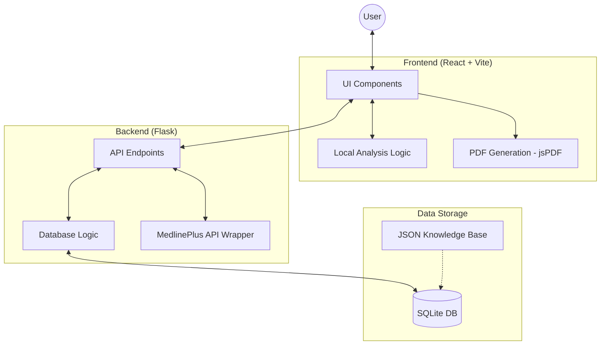
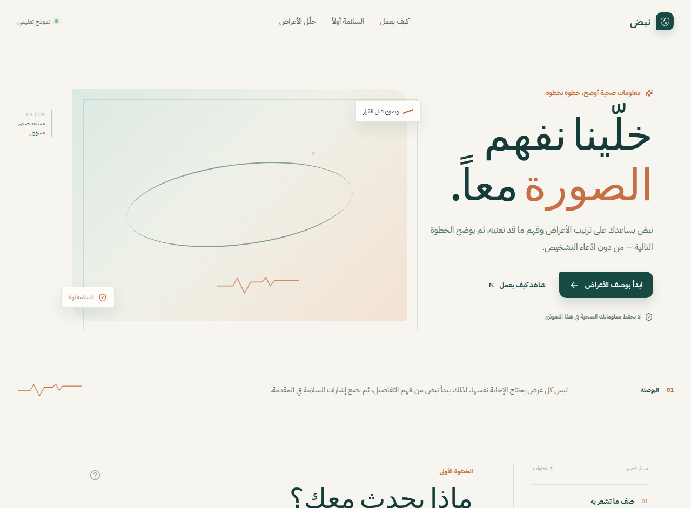
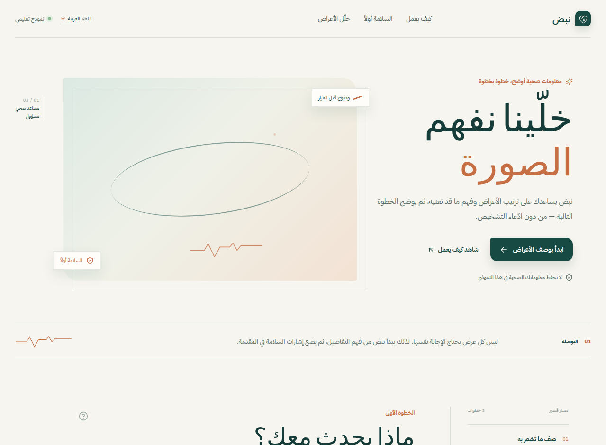

# نبض — مساعد صحي تعليمي

نبض نموذج أولي لمساعد صحي يترجم وصف الأعراض إلى قراءة أولية قابلة للفهم. هو ليس أداة تشخيص، ولا يصف علاجاً، ولا يحاول أن يحل محل الطبيب أو الصيدلي. الهدف من المشروع هو اختبار فكرة صغيرة ومسؤولة: هل يمكن لواجهة واضحة وقواعد أمان مستقلة أن تساعد المستخدم على تنظيم ما يشعر به ومعرفة متى يحتاج إلى رعاية عاجلة؟

النسخة الحالية تدعم العربية والفرنسية والإنجليزية. تغيير اللغة يبدّل النصوص واتجاه الكتابة، كما يغيّر لغة الأعراض والنتائج داخل التقرير وفي ملف PDF.

## الحالة الحالية

المشروع يعمل كتجربة تعليمية محلية. توجد واجهة قابلة للاستخدام، وفهرس طبي صغير، وخلفية Flask، وقاعدة SQLite، وتصدير PDF. لا أتعامل مع النتائج على أنها دقيقة سريرياً؛ الفهرس الحالي محدود ومقصود به تجربة تدفق المنتج والمنطق، وليس تقديم خدمة طبية فعلية.

| الجزء | ما يفعله الآن |
| --- | --- |
| الواجهة | نموذج أعراض متجاوب بالعربية والفرنسية والإنجليزية، مع RTL للعربية وLTR للغتين الأخريين. |
| التحليل | يطابق الأعراض والمرادفات، يحسب تغطية كل حالة، ويرتب النتائج بمؤشر توجيهي بسيط. |
| الأمان | يفحص إشارات الخطر بشكل مستقل، ولا يسمح للنتيجة العامة بأن تطغى على التحذير العاجل. |
| المصادر | روابط MedlinePlus لكل حالة، وبيانات وصفية عن Disease Ontology، وذاكرة مؤقتة لبحث MedlinePlus. |
| التقرير | يلتقط نتيجة التحليل الحالية بصرياً ويحفظها PDF باللغة المختارة. |
| الخصوصية | لا يحفظ الأعراض أو الاسم أو الموقع؛ تسجل SQLite إحصاءات مجهولة عن الفحص فقط. |

## التشغيل

يحتاج المشروع إلى Node.js وpnpm وPython 3.10 أو أحدث. لتشغيل الواجهة أثناء التطوير:

```bash
pnpm install
pnpm run dev
```

ثم افتح `http://localhost:5173`. يمكن بدء الواجهة بلغة محددة من خلال `/?lang=ar` أو `/?lang=fr` أو `/?lang=en`.

لتشغيل الخلفية مع SQLite:

```bash
python3 -m venv .venv
source .venv/bin/activate
pip install -r requirements.txt
pnpm run build
python3 run.py
```

بعد البناء، تخدم Flask الملفات من مجلد `dist` وتوفر المسارات التالية:

| المسار | الغرض |
| --- | --- |
| `GET /api/health` | فحص سريع لحالة الخلفية. |
| `POST /api/check` | تحليل الأعراض مع اللغة المختارة. |
| `GET /api/medical-search?q=...` | بحث احتياطي في MedlinePlus مع تخزين مؤقت. |

## Technical Architecture | الهندسة التقنية



### لماذا اخترت هذه الـ architecture؟

لم أستخدم بنية كبيرة متعددة الخدمات لأن المشروع لا يحتوي حالياً على حسابات مستخدمين، أو صلاحيات، أو طوابير، أو حاجة إلى تشغيل موزع. فصلت الأجزاء حسب مسؤوليتها العملية، وليس حسب أسماء معمارية عامة يصعب تتبعها.

### الواجهة: React + Vite + JavaScript

اخترت React لأن النموذج يتغير في حالات كثيرة: اللغة، حقول السياق، حالة التحليل، التحذير، وزر PDF. React يجعل هذه الحالات صريحة في الصفحة بدلاً من توزيعها على معالجات DOM كثيرة. استخدمت Vite لأن المطلوب واجهة سريعة للتطوير والبناء، وليس خادماً كاملاً للصفحات.

التزمت بـ JavaScript فقط كما طلب المستخدم. لا توجد ملفات TypeScript أو TSX. وضعت النصوص في `client/src/copy.js` والبيانات الطبية في `client/src/medical_data.js` حتى لا تختلط الترجمة بمنطق الصفحة.

### الخلفية: Flask + SQLite

استخدمت Flask لأن الخلفية صغيرة: مسار تحليل، مسار صحة، ومسار بحث. لا توجد فائدة حالياً من إطار أثقل أو طبقة خدمات متعددة. SQLite مناسبة للنسخة المحلية لأنها لا تحتاج خادماً منفصلاً، وتوفر جداول يمكن فحصها واستبدالها لاحقاً بقاعدة أكبر إذا توسع المشروع.

### البيانات: JSON مصدر + SQLite فهرس تشغيل

ملف `data/medical_data.json` هو المصدر القابل للمراجعة داخل المشروع. عند تشغيل الخلفية، تُنسخ الحالات والأعراض والمصادر إلى SQLite لتسهيل القراءة والاستعلام. بهذه الطريقة لا تصبح قاعدة SQLite ملفاً غامضاً لا يمكن مراجعته في Git، ولا تضطر الواجهة إلى قراءة قاعدة SQLite مباشرة.

### التحليل: مطابقة محلية ثم بحث خارجي محدود

يبدأ التحليل من الفهرس المحلي حتى يكون سريعاً ويعمل دون اتصال. كل حالة مرتبطة بمجموعة أعراض ومرادفات بثلاث لغات، وتحصل على `coverage` يعبّر عن عدد الأعراض المطابقة مقارنة بعدد الأعراض المفهرسة للحالة. توجد أيضاً أولوية توجيهية بسيطة للحالات الشائعة حتى لا تتقدم حالة أقل شيوعاً لمجرد أنها تملك نفس عدد التطابقات.

عند عدم وجود نتائج محلية، يمكن للخلفية طلب نتائج من خدمة MedlinePlus ثم حفظها 24 ساعة. MedlinePlus توفر خدمة بحث وملفات XML لموضوعات الصحة، وتطلب نسب المصدر وتوصي بالتخزين المؤقت واحترام حد الطلبات [1]. استخدمت Disease Ontology كمرجع مصطلحات مفتوح بترخيص CC0، وليس كمصدر وحيد لعلاقة عرض-مرض [2].

### الأمان: طبقة منفصلة عن الترتيب

فحص الخطر لا يعتمد على أن الحالة احتلت المرتبة الأولى. توجد مجموعة مستقلة من إشارات مثل ألم الصدر، صعوبة التنفس، الإغماء، النزيف الشديد، الضعف المفاجئ، والتشوش المفاجئ. إذا ظهرت إشارة منها، يظل التحذير ظاهراً حتى لو لم يجد النظام حالة مناسبة في الفهرس.

### PDF: تصدير من الواجهة عند الطلب

يستخدم زر التقرير `html2canvas` لالتقاط بطاقة النتيجة و`jsPDF` لحفظها. اخترت هذا الأسلوب لأن التقرير يجب أن يطابق ما يراه المستخدم فعلياً، بما في ذلك العربية واتجاه RTL. يتم تحميل المكتبتين بشكل مؤجل عند الضغط على الزر فقط؛ وجودهما لا يزيد التحميل الأولي للواجهة بنفس الحجم.

## بنية الملفات

```text
ai-health-assistant/
├── client/
│   ├── index.html
│   └── src/
│       ├── components/       عناصر العلامة والتنبيهات وخط النبض
│       ├── pages/            الصفحة الرئيسية والنموذج والنتائج
│       ├── App.jsx
│       ├── check.js          التحليل المحلي في الواجهة
│       ├── copy.js           النصوص العربية والفرنسية والإنجليزية
│       ├── medical_data.js   نسخة الواجهة من الفهرس الطبي
│       └── index.css
├── backend/
│   ├── app.py                مسارات Flask
│   ├── medical.py            التحليل المحلي في الخلفية
│   ├── medline.py            بحث MedlinePlus والذاكرة المؤقتة
│   ├── db.py                 جداول SQLite والمزامنة
│   └── update_medical.py     تحديث الفهرس والنتائج المخبأة
├── data/
│   └── medical_data.json     مصدر البيانات القابل للمراجعة
├── docs/
│   ├── medical_sources.md
│   └── screenshots/
├── tests/
├── makeData.js               مزامنة JSON إلى medical_data.js
└── run.py
```

## Screenshots | لقطات الشاشة

هذه الصور ليست لقطات تسويقية؛ هي لقطات من معاينات التطوير التي استخدمتها لمراجعة الاتجاه البصري وتدرج الميزات.

### 1. النسخة العربية الأولى



بدأت الواجهة كنسخة عربية فقط، مع نموذج الأعراض وقسم السلامة والتخطيط التحريري.

### 2. بعد إضافة اللغات الثلاث


في هذه المرحلة أصبح تغيير اللغة يبدّل النصوص واتجاه الصفحة، مع إبقاء الهوية البصرية ثابتة.

### 3. النسخة التي تتضمن تقرير PDF



هذه لقطة للنسخة التي سبقت إضافة زر تصدير التقرير النهائي، مع الحفاظ على حجم الواجهة ووضوح النموذج.

## Challenges & What I Learned

### تحويل قالب TypeScript إلى JavaScript بالكامل

كان القالب الأول يحتوي على ملفات `ts` و`tsx` وملفات إعداد تتوقع وجود `tsconfig`. حذف امتدادات TypeScript وحده لم يكن كافياً؛ ظل فحص القالب يحاول تشغيل TypeScript ويعتبر عدم وجود مدخلات خطأ. حوّلت نقطة الدخول والإعدادات إلى JavaScript، حذفت إعدادات TypeScript القديمة، وأضفت اختباراً يبحث عن أي ملف `ts` أو `tsx` قبل التسليم. تعلمت من ذلك أن تغيير اللغة ليس إعادة تسمية للملفات فقط، بل يجب مراجعة أوامر البناء والفحص والقالب نفسه.

### الاعتماد على مصدر طبي حقيقي دون الادعاء بوجود تشخيص

كان من السهل وضع قائمة أمراض ثابتة وعرضها كأنها قاعدة معرفة. هذا غير مناسب لمشروع صحي. لذلك فصلت بين فهرس صغير قابل للمراجعة، وروابط المصادر الرسمية، وبحث احتياطي محدود في MedlinePlus. أبقيت النتيجة "احتمالاً تعليمياً" وأبقيت إشارات الخطر في طبقة منفصلة. ما تعلمته هنا أن المصدر الموثوق لا يجعل الخوارزمية تشخيصية تلقائياً؛ ما زالت طريقة الترتيب وحدود البيانات مهمة.

### إضافة مكتبات PDF دون التضحية بسرعة البداية

إضافة `jspdf` و`html2canvas` رفعت حجم الحزمة الأولية كثيراً عندما استوردتهما الصفحة مباشرة. الحل كان تحويل الاستيراد إلى `dynamic import` داخل زر التصدير. أصبحت الصفحة تحمل مكتبات PDF فقط عندما يطلب المستخدم التقرير، بينما تبقى الوظيفة نفسها متاحة عند الحاجة.

## الاختبارات

```bash
pnpm run build
pnpm run check
python3 tests/check.py
python3 tests/medical.py
python3 -m py_compile backend/*.py run.py tests/check.py tests/medical.py
```

الاختبارات تغطي المطابقة العربية والفرنسية، حالة عادية، حالة طوارئ، وجود المصادر، وجداول SQLite الأساسية. لا تغطي هذه الاختبارات دقة طبية حقيقية؛ قياس الدقة والحساسية يحتاج مجموعة حالات مراجعة من مختصين ومقارنة منهجية.

## ما لم أبنه بعد

لا توجد مصادقة، ولا تخزين لملفات المستخدمين، ولا تكامل مكتمل مع مستشفيات فعلية، ولا وصفات أو تداخلات دوائية. كذلك لا يوجد نموذج لغوي كبير داخل التحليل؛ الاعتماد الحالي على المطابقة المنظمة مقصود لأنه أسهل في التفسير والمراجعة. إضافة نموذج لغوي قبل بناء مجموعة تقييم وسياج أمان أقوى ستزيد التعقيد أكثر مما تزيد الثقة.

## الخصوصية والسلامة

لا تكتب اسماً أو رقم هوية أو معلومات يمكن أن تحدد شخصاً. البيانات الصحية حساسة، وهذه النسخة مخصصة للتجربة المحلية. عند ظهور أعراض طارئة، لا تنتظر نتيجة نبض؛ تواصل مع خدمات الطوارئ أو اذهب إلى أقرب قسم طوارئ.

## المراجع

[1]: https://medlineplus.gov/about/developers/webservices/ "MedlinePlus Web Service — National Library of Medicine"

[2]: https://disease-ontology.org/ "Human Disease Ontology — official releases and API"

[3]: https://pmc.ncbi.nlm.nih.gov/articles/PMC6486985/ "An open access medical knowledge base for community driven diagnostic decision support system development"
